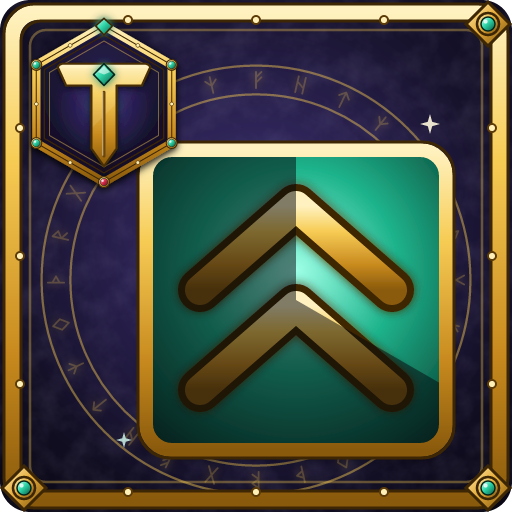

# Tylesser - Buff Tracker

A World of Warcraft addon that **reminds you when a buff is missing**. Choose the buffs you care about, like Righteous Fury or your blessings, and an icon appears on screen whenever one of them isn't on you. In a group, **buttons appear next to your party frames** for the buffs your party is missing: click one to cast it on that member.

## Features

- **You choose what to track.** Pick from the buffs on you right now or from the spells in your spellbook, search by name, or type a name or spell ID.
- **Every rank counts.** Buffs are matched by name, so any rank of a spell counts as that buff.
- **Choose when each buff shows:**
  - **When missing** (the default): only while it's not on you.
  - **When active:** only while it's on you.
  - **Always:** in full color while it's on you, dimmed with a red border while it's missing.
- **Time left and stacks** on icons of active buffs. The time turns red in the last minute.
- **Move and resize.** The icons start at the top of the screen. Drag the row wherever you want it and set the icon size.
- **Saved per character,** because each class watches different buffs.

## Party buff buttons

When a party member is missing one of your group buffs, a small button with the buff's icon appears next to their party frame. Click it to cast the buff on them. The button goes away once they have it.

- **Group spell first, then the single one.** The button uses the group spell when you can cast it, and the single-target spell when you can't, usually because you're out of the reagent:
  - Arcane Brilliance (Arcane Powder) → Arcane Intellect
  - Prayer of Fortitude (Holy or Sacred Candle) → Power Word: Fortitude
  - Prayer of Spirit → Divine Spirit, Prayer of Shadow Protection → Shadow Protection (Sacred Candle)
  - Gift of the Wild (Wild Berries or Wild Thornroot) → Mark of the Wild
  - Greater Blessing (Symbol of Kings) → Blessing
- **Only where it helps.** Arcane Intellect and Divine Spirit aren't offered to warriors and rogues. Members who are dead or offline get no buttons.
- **Paladin blessings:** choose a blessing for each class, like Might for warriors and Wisdom for casters, and change it for single party members. A member's own choice is kept by name.
- **The tooltip** shows who is missing the buff, how many reagents you have, and when the single-target spell is used instead.
- **Colors:** red icon = out of range, blue icon = not enough mana.
- **Distance limit:** members farther than 60 yards get no buttons, so you only see buffs you can walk over and give. Closer members keep theirs, red while out of spell range. Pick 30, 40, 60, 80 or 100 yards on the options page, or untick the box to always show them. In dungeons and raids the game doesn't give addons exact positions, so there a member is hidden only once they're out of sight (about 100 yards), or past about 40 yards with a 30 or 40 yard limit.
- **Ending soon:** buffs that end within a minute also get a button, so you can refresh them in time. Click the time on the options page to pick 10 sec, 30 sec, 1 min, 2 min or 5 min, or untick the box to only show missing buffs.
- Works with Blizzard's party frames, raid-style party frames, ElvUI and FlareUI, and finds the party frames of most other unit frame addons too. Your own buffs are in the icon row, so your own frame gets no buttons, except in raid-style party frames.

**In combat** the game doesn't let addons add, move or remove these buttons. Buttons that are already there keep working, and a buff that lands only dims its button. Everything updates as soon as combat ends.

Turn each group buff on or off and set the blessings at Esc > Options > AddOns > Tylesser - Buff Tracker > Party buffs, or with `/btrack party`.

## Usage

Type `/btrack` to open the options, or go to Esc > Options > AddOns > Tylesser - Buff Tracker. Click a buff on the right to track it, then use the button next to it to choose when it shows. To move the icons, untick **Lock position** and drag them.

- `/btrack`: open the options
- `/btrack party`: open the party buff options (group buffs and blessings)
- `/btrack add <name or spell ID>`: track a buff
- `/btrack remove <name>`: stop tracking a buff
- `/btrack list`: show the tracked buffs and their state
- `/btrack lock` / `/btrack unlock`: lock or move the icons
- `/btrack reset`: put the icons back at the top of the screen
- `/btrack debug`: show what the party buttons see (which frame each member has, and which buffs they're missing), useful for bug reports

A name you type must match the buff's name, but capitals don't matter. If the game doesn't know the spell yet, the icon is a question mark until the buff first appears on you.

Related buffs count separately. Gift of the Wild doesn't count as Mark of the Wild, so track the one you use.

## When the game hides buffs

WoW Forever and Retail can hide buff details from addons at times, such as during combat. While buffs are hidden, each icon keeps what it last knew and keeps counting down. If the time runs out, the icon turns grey, because the addon can't tell whether the buff was refreshed. Everything updates again as soon as the game stops hiding buffs.

## Installation

Install from CurseForge, or download the latest zip from [Releases](https://github.com/Tylesser/BuffTracker/releases) and extract it to `Interface/AddOns`. The folder must be named `BuffTracker`.

## Releasing (maintainers)

Releases are built by [BigWigsMods/packager](https://github.com/BigWigsMods/packager). Push a version tag to publish to GitHub Releases and CurseForge:

```
git tag v1.0.0
git push origin v1.0.0
```

## License

[MIT](LICENSE)
