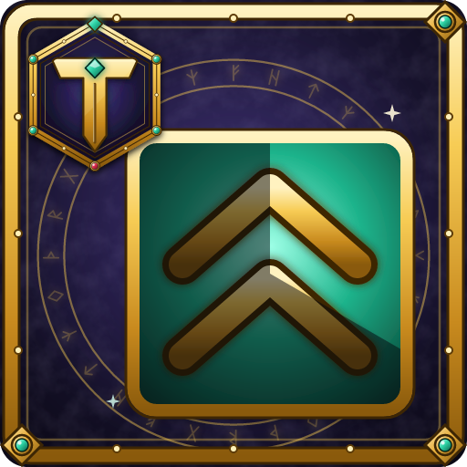

# Tylesser - Buff Tracker

A World of Warcraft addon that **reminds you when a buff is missing**. Choose the buffs you care about, like Righteous Fury, your blessings or an elixir, and an icon appears on screen whenever one of them isn't on you. In a group, **buttons appear next to your party and raid frames** for the buffs your group is missing: click one to cast it on that member. **Dispel buttons** do the same for debuffs you can remove, like a poison or a curse, on your party and on yourself.

## Features

- **You choose what to track.** Pick from the buffs on you right now or from the spells in your spellbook, search by name, or type a name or spell ID.
- **Class basics in one click.** The **Add <class> basics** button (or `/btrack basics`) tracks the basic buffs of your class that you know: Arcane Intellect and your best armor for mages, Power Word: Fortitude, Inner Fire and Divine Spirit for priests, Mark of the Wild and Thorns for druids, your best armor for warlocks, Battle Shout for warriors, Trueshot Aura and your aspect for hunters, your shield for shamans, and Devotion Aura and your blessing for paladins.
- **Every rank counts.** Buffs are matched by name, so any rank of a spell counts as that buff.
- **Choose when each buff shows:**
  - **When missing** (the default): only while it's not on you.
  - **When active:** only while it's on you.
  - **Always:** in full color while it's on you, dimmed with a red border while it's missing.
- **Choose where and when the row shows.** Click **Where the row shows** above the tracked list and tick the places (open world, cities and inns, dungeons, raids, battlegrounds and arenas), the group (solo, in a party, in a raid group), your talents (primary or secondary, where the game has dual spec), your group role (tank, healer, damage or no role set) and the combat state (in and out of combat, only in combat, only out of combat) to show the icons in. For example: hidden in dungeons and raids, but shown in a party out in the world. A buff can have its own rules: click **Where** under it (its button turns green). While you move the row, every icon shows.
- **Warn me to remove it (optional).** Tick **Warn me when a buff with rules is on where they say no** in the same window, and a buff that is on where its rules say it shouldn't be (Righteous Fury out in the world, say) shows in the row in red with "remove" under it, and chat names it once. Click the icon to remove the buff (out of combat). Off by default.
- **Click to cast.** Click the icon of a buff you know the spell for, like Arcane Intellect or a blessing, to cast it on yourself. This works out of combat: the game doesn't let addons change clickable buttons in combat, so the icons can't be clicked then. Turn it off on the options page if you'd rather the icons never take a click.
- **Click to use items.** For a buff you don't have the spell for, like an elixir or a scroll, clicking the icon uses the item of the same name from your bags. You can also choose the item yourself: click **Use item** under a tracked buff on the options page to go through the usable items in your bags (right-click for none; items you wear, like trinkets, aren't offered), or type `/btrack item Well Fed = Spiced Wolf Meat`. The icon shows how many you have left, with a red 0 and no click once they're gone.
- **Weapon enchants.** Track **Main-hand weapon enchant** or **Off-hand weapon enchant** (at the end of the list on the right) to see when your oil, poison or sharpening stone is missing. Choose the item under it, and a click puts it on that weapon.
- **Alert in combat.** Tick **Alert** under a tracked buff to hear the raid warning sound and see its icon flash when that buff drops during combat. This only works while the game lets addons see your buffs in combat (see below).
- **Time left and stacks** on icons of active buffs. The time turns red in the last minute.
- **Move and resize.** The icons start at the top of the screen. Drag the row wherever you want it, in Edit Mode or after unticking Lock position, and set the icon size.
- **Square or round.** Show the icons, and the buttons next to party frames, as squares with a gold border or as circles with a gold ring.
- **Saved per character,** because each class watches different buffs.

## Party buff buttons

When a party member is missing one of your group buffs, a small button with the buff's icon appears next to their party frame. Click it to cast the buff on them. The button goes away once they have it.

- **Group spell first, then the single one.** The button uses the group spell when you can cast it, and the single-target spell when you can't, usually because you're out of the reagent:
  - Arcane Brilliance (Arcane Powder) → Arcane Intellect
  - Prayer of Fortitude (Holy or Sacred Candle) → Power Word: Fortitude
  - Prayer of Spirit → Divine Spirit, Prayer of Shadow Protection → Shadow Protection (Sacred Candle)
  - Gift of the Wild (Wild Berries or Wild Thornroot) → Mark of the Wild
  - Greater Blessing (Symbol of Kings) → Blessing, but only in a raid: in a party, or alone, the buttons cast the normal Blessing
- **Only where it helps.** Arcane Intellect and Divine Spirit aren't offered to warriors and rogues. Members who are dead or offline get no buttons.
- **Camp buffs (WoW Forever):** a camp buff that doesn't stack with a class buff counts as that buff. A member with Boosted Stamina from a First Aid Kit gets no Power Word: Fortitude button; the same goes for Boosted Intellect (Arcane Intellect), Boosted Spirit (Divine Spirit), Boosted Stats from the Enchanted Lute (Mark of the Wild) or the Fish Bowl (Blessing of Kings), Boosted Attack Power (Blessing of Might) and Boosted Mana Regeneration (Blessing of Wisdom).
- **Paladin blessings:** choose a blessing for each class, like Might for warriors and Wisdom for casters, and change it for single party members. A member's own choice is kept by name.
- **Every blessing when it helps (paladins):** when a member has no blessing at all, or another paladin already gave them the one you chose, a button appears for each blessing they don't have yet, so you can pick one that isn't taken. Once they have a blessing from you, the others go away. Blessings from other paladins never hide yours, as each paladin keeps one blessing of their own on a member. When the game doesn't say who cast a blessing, only your chosen one shows. Turn this off on the options page to only see the chosen blessing.
- **The tooltip** shows who is missing the buff, how many reagents you have (in orange when you're running low), and when the single-target spell is used instead.
- **Low reagent warning:** a chat message such as "3 Symbol of Kings left." each time a reagent you use goes down to 5 or fewer. Pick 1, 3, 5, 10 or 20 on the Party buffs page, or Off. The reagents follow your game version: Wild Quillvine for Gift of the Wild on TBC, Wild Spineleaf and Devout Candle on Wrath, and no reagents from Mists of Pandaria on.
- **Colors:** red icon = out of range, blue icon = not enough mana.
- **Distance limit:** members farther than 60 yards get no buttons, so you only see buffs you can walk over and give. Closer members keep theirs, red while out of spell range. Pick 30, 40, 60, 80 or 100 yards on the options page, or untick the box to always show them. In dungeons and raids the game doesn't give addons exact positions, so there a member is hidden only once they're out of sight (about 100 yards), or past about 40 yards with a 30 or 40 yard limit.
- **Ending soon:** buffs that end within a minute also get a button, so you can refresh them in time. Click the time on the options page to pick 10 sec, 30 sec, 1 min, 2 min or 5 min, or untick the box to only show missing buffs.
- Works with Blizzard's party frames, raid-style party frames, ElvUI and FlareUI, and finds the party frames of most other unit frame addons too. Your own buffs are in the icon row, so your own frame gets no buttons, except in raid-style party frames.
- **In a raid** every member is covered, with small buttons in the top right corner of each raid frame (at most a third of its width). **Raid buttons hide during combat**, so a click on a raid frame always reaches the frame, for healing. Untick **Buttons on raid frames** on the Party buffs page to have none in raids.
- **Resurrect the dead:** a member who died (and hasn't released) gets one button with your class's resurrection spell in place of their buffs. It dims while someone else is already resurrecting them. Untick **Resurrect the dead** to turn it off.

**In combat** the game doesn't let addons add, move or remove these buttons. Buttons that are already there keep working, and a buff that lands only dims its button. Everything updates as soon as combat ends.

Turn each group buff on or off and set the blessings at Esc > Options > AddOns > Tylesser - Buff Tracker > Party buffs, or with `/btrack party`.

## Dispel buttons

When a party or raid member has a debuff you can remove, a button with the debuff's icon appears next to their frame, after any buff buttons. Its border has the debuff type's color: blue for Magic, purple for Curse, brown for Disease, green for Poison. Click it to cast your dispel on them. A row of the same buttons for yourself sits under your icon row.

- **It follows the spells you know.** A paladin with Purify gets buttons for Poison and Disease, and once they learn Cleanse, for Magic too. When two of your spells remove the same type, the better one is used: Cleanse over Purify, Abolish Disease over Cure Disease, Abolish Poison over Cure Poison.
- **Every class with a dispel:** paladins (Purify, Cleanse), priests (Dispel Magic, Cure Disease, Abolish Disease), druids (Remove Curse, Cure Poison, Abolish Poison), shamans (Cure Poison, Cure Disease; Cure Toxins and Cleanse Spirit on Wrath) and mages (Remove Lesser Curse, Remove Curse). From Mists of Pandaria on, the game itself tells which debuffs your spec can remove, and monks and evokers are covered too.
- **The tooltip** lists the debuffs the button removes.
- **Colors:** red icon = out of range, blue icon = not enough mana. Members farther than the distance limit get no dispel buttons either.
- **In combat:** the game doesn't let addons add or move clickable buttons during a fight. So a debuff that shows up in combat gets a plain icon in the same place instead: the same picture and border color, but it takes no clicks, so a click there reaches the frame under it. Buttons that were there before the fight keep working. After combat the icons go and the buttons come back. Untick **Show dispel icons in combat** on the Dispels page if you'd rather see nothing new during a fight.
- **Raids too:** in a raid the buttons sit in the top right corner of each raid frame, like the buff buttons, and hide during combat; the plain icons take their place there. Your own row works anywhere, also when you play alone.

Turn either one off at Esc > Options > AddOns > Tylesser - Buff Tracker > Dispels, or with `/btrack dispel`. That page also lists the dispels you know and what each one removes.

## Usage

Type `/btrack` to open the options, go to Esc > Options > AddOns > Tylesser - Buff Tracker, or pick Buff Tracker in the addon menu by the minimap. Click a buff on the right to track it, then use the button next to it to choose when it shows. To move the icons, open Edit Mode (Esc > Edit Mode) and drag the Buff Tracker row, or untick **Lock position** and drag them.

- `/btrack`: open the options
- `/btrack party`: open the party buff options (group buffs and blessings)
- `/btrack dispel`: open the dispel options
- `/btrack add <name or spell ID>`: track a buff
- `/btrack basics`: track the basic buffs of your class
- `/btrack item <buff> = <item>`: the item a click on that icon uses (name, item ID or shift-clicked link); `/btrack item <buff>` for none
- `/btrack remove <name>`: stop tracking a buff
- `/btrack list`: show the tracked buffs and their state
- `/btrack lock` / `/btrack unlock`: lock or move the icons
- `/btrack reset`: put the icons back at the top of the screen
- `/btrack debug`: show what the party buttons see (which frame each member has, which buffs they're missing and which debuffs you can remove), useful for bug reports
- `/btrack feedback`: get the link to report a bug or suggest an idea

A name you type must match the buff's name, but capitals don't matter. If the game doesn't know the spell yet, the icon is a question mark until the buff first appears on you.

Related buffs count separately. Gift of the Wild doesn't count as Mark of the Wild, so track the one you use.

## When the game hides buffs

WoW Forever and Retail can hide buff details from addons at times, such as during combat. While buffs are hidden, each icon keeps what it last knew and keeps counting down. If the time runs out, the icon turns grey, because the addon can't tell whether the buff was refreshed. Everything updates again as soon as the game stops hiding buffs. While buffs are hidden the addon can't see one drop, so **Alert** can't go off then. Hidden debuffs get no dispel button.

## Feedback

Found a bug or have an idea? Click **Feedback** on the options page or type `/btrack feedback` in game to get the link, or go straight to [tylesser.com/feedback](https://tylesser.com/feedback/#bufftracker).

No GitHub account? Join the [Tylesser Discord](https://discord.gg/n2rEB6mRxF) and post in #bug-reports or #ideas with the addon's tag; each post is copied to GitHub and the bot answers with the link.

## Installation

Install from CurseForge, or download the latest zip from [Releases](https://github.com/Tylesser/BuffTracker/releases) and extract it to `Interface/AddOns`. The folder must be named `BuffTracker`.

## Releasing (maintainers)

Releases are built by [BigWigsMods/packager](https://github.com/BigWigsMods/packager). Push a version tag to publish to GitHub Releases and CurseForge:

```
git tag v1.0.0
git push origin v1.0.0
```

## License

[MIT](LICENSE)
